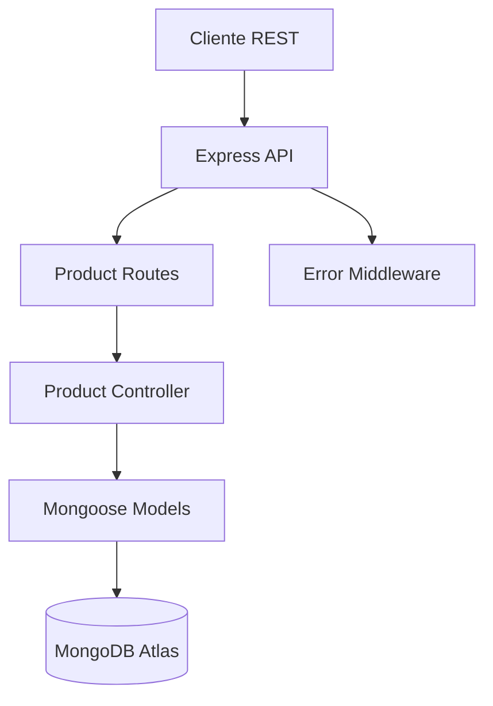

# REWEAR API - PEC3

## Descripción

REWEAR es una API REST para una plataforma de compraventa de ropa de segunda mano. Permite gestionar productos mediante operaciones CRUD (crear, consultar, actualizar y eliminar).

La API está desarrollada con Node.js y Express, utiliza Mongoose para conectarse a MongoDB Atlas y está desplegada en Vercel.

## Tecnologías utilizadas

- Node.js
- Express
- MongoDB Atlas
- Mongoose
- dotenv
- Vercel

## Modelos de datos

### User

- `name`: nombre del usuario.
- `email`: correo electrónico.
- `createdAt`: fecha de creación.

### Product

- `name`: nombre del producto.
- `description`: descripción.
- `price`: precio.
- `size`: talla.
- `category`: categoría.
- `condition`: estado de la prenda.
- `image`: URL de la imagen.
- `userId`: referencia al usuario propietario.
- `available`: disponibilidad del producto.

## Endpoints

| Método | Endpoint | Descripción |
|---|---|---|
| GET | `/api/products` | Obtener todos los productos |
| GET | `/api/products/:id` | Obtener producto por ID |
| POST | `/api/products` | Crear un producto |
| PUT | `/api/products/:id` | Actualizar un producto |
| DELETE | `/api/products/:id` | Eliminar un producto |

## Instalación

Clonar el repositorio e instalar las dependencias:

```bash
npm install
```

Crear un archivo `.env` a partir de `.env.example` y configurar las variables necesarias.

## Variables de entorno

- `PORT`: puerto del servidor.
- `MONGODB_URI`: cadena de conexión a MongoDB Atlas.

## Ejecución

Iniciar el servidor:

```bash
npm start
```

La API estará disponible localmente en:

`http://localhost:3000`

## Despliegue

La API está desplegada en Vercel:

https://pec-api.vercel.app

Repositorio de GitHub:

https://github.com/abrahammeza17/pec-api

La aplicación utiliza la variable de entorno `MONGODB_URI` configurada en Vercel para conectarse a MongoDB Atlas.

## Pruebas

Los archivos de prueba están disponibles en la carpeta `tests`:

- `products.http`
- `products.postman.json`

## Gestión de errores

La API incluye dos middlewares:

- **404 Not Found:** gestiona las rutas inexistentes.
- **500 Error Handler:** gestiona los errores internos y devuelve respuestas JSON.

## Diagrama de arquitectura


