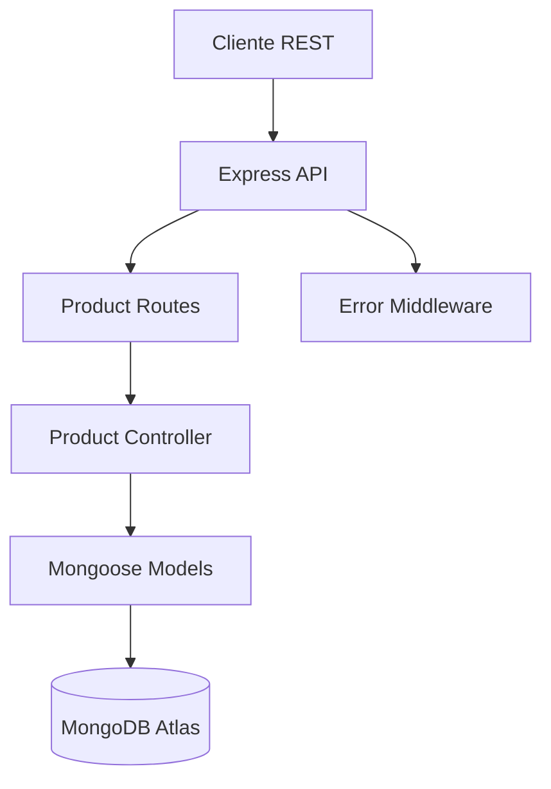

# REWEAR API - PEC3

## Descripción

REWEAR es una API REST para una plataforma de compraventa de ropa de segunda mano. Permite gestionar productos mediante operaciones CRUD y utiliza MongoDB Atlas como base de datos.

## Tecnologías utilizadas

- Node.js
- Express
- MongoDB Atlas
- Mongoose
- dotenv

## Modelos de datos

### User

- name: nombre del usuario.
- email: correo electrónico.
- createdAt: fecha de creación.

### Product

- name: nombre del producto.
- description: descripción.
- price: precio.
- size: talla.
- category: categoría.
- condition: estado de la prenda.
- image: URL de la imagen.
- userId: referencia al usuario propietario.
- available: disponibilidad del producto.

## Endpoints

| Método | Endpoint | Descripción |
|---|---|---|
| GET | /api/products | Obtener todos los productos |
| GET | /api/products/:id | Obtener producto por ID |
| POST | /api/products | Crear un producto |
| PUT | /api/products/:id | Actualizar un producto |
| DELETE | /api/products/:id | Eliminar un producto |

## Instalación

Clonar el repositorio e instalar las dependencias:

    npm install

Configurar las variables de entorno creando un archivo `.env` a partir de `.env.example`.

## Variables de entorno

- PORT: puerto del servidor.
- MONGODB_URI: conexión a MongoDB Atlas.

## Ejecución

Iniciar el servidor:

    npm start

La API estará disponible en:

    http://localhost:3000

## Pruebas

Las peticiones de prueba están disponibles en la carpeta `tests`:

- products.http
- products.postman.json

## Gestión de errores

La API incluye middleware para gestionar rutas no encontradas (404) y errores internos del servidor (500).

## Diagrama de arquitectura

